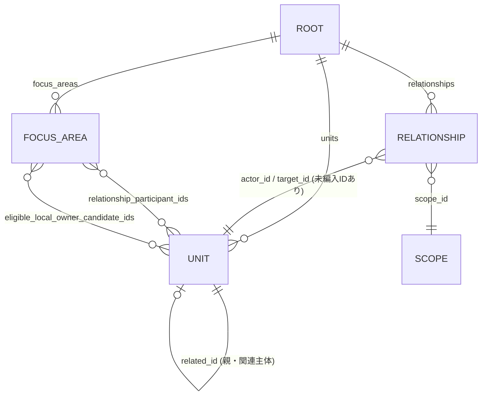

# 領土関係・タイル割当候補データ（JSON）データ辞書

対象: [`documents/spec/data/territory-allocation-candidates.json`](data/territory-allocation-candidates.json)（旧名 `領土関係・タイル割当候補データ.json`）（`schema_version: 1`）

このJSONは SSOT 14.4 / 14.5 の**派生データ**であり、仕様の正本ではない（SSOT 19.1）。規則の根拠は SSOT [3.3](ssot/03-map-and-scale.md)「領土主張と単一タイル所有の割当規則」と [14.5](ssot/14-5-territory-model.md) を参照する。本書はフィールドの意味・取りうる値・不変条件・既知の注意点だけを扱う。

## 前提: まだ「タイル所有」は1件も決まっていない

- `tile_geometry_available: false`、`scenario_reference_date: null`
- 全851主体・全27地域で `tile_ids: []`、`geometry_ref: null`、`assigned_tile_owner_id: null`
- 「候補」は後で地理と統治の裏付けを照合するためのIDで、Civ6 の実タイルに所有者を設定したものではない

実ポリゴン・タイル座標・基準日がない状態で、実タイルの所有者を埋めてはならない（SSOT 14.5）。

## 全体構造

### ルート

| キー | 型 | 値（現状） | 意味 |
|---|---|---|---|
| `schema_version` | int | `1` | スキーマ版 |
| `evidence_cutoff` | string | `2026-09-28` | 調査の証拠上限日 |
| `scenario_reference_date` | string \| null | `null` | シナリオ開始の基準日。未設定 |
| `tile_geometry_available` | bool | `false` | 実ポリゴン・タイル座標の有無 |
| `pending_actor_ids` | string[] | 6件 | 未編入の参照ID。タイル所有者にできない |
| `audit_area_ids` | string[] | `SGS`, `VE-W` | 地域監査ID。独立勢力IDではない |
| `meaning` | string | — | データの意味の一文説明 |
| `policy` | object | 下表 | 割当規則フラグ |
| `counts` | object | 下表 | 件数の集計 |
| `units` | object[] | 851件 | 収録主体ごとの割当候補 |
| `relationships` | object[] | 682件 | 主体間の関係 |
| `focus_areas` | object[] | 27件 | 重点地域（係争・自治等）の割当候補 |

`pending_actor_ids`: `POLISARIO`, `SOM-NES`, `SOM-PL`, `SSD-ABY`, `SSD-GPB`, `SSD-RUW`

### `policy`

すべて SSOT 3.3 / 14.5 の規則をフラグ化したもの。

| キー | 値 | 意味 |
|---|---|---|
| `claim_is_relationship_not_tile_owner` | `true` | 領有権の主張は関係として記録し、タイル所有にしない |
| `at_most_one_owner_per_tile` | `true` | 1タイルの所有者は最大1主体 |
| `prefer_smallest_included_geographic_unit` | `true` | 収録済みの最小地理単位を優先する |
| `same_rank_tiebreak` | `verified_local_control_else_unowned_for_review` | 同順位では検証済みの実効統治、決まらなければ未所有・監査対象 |
| `unregistered_actor_cannot_own_tile` | `true` | 未登録主体はタイル所有者になれない |
| `free_association_is_not_parent_tile_ownership` | `true` | 自由連合は相手国のタイル所有ではない |
| `size_classification_uses_sourced_area_not_initial_owned_tile_count` | `true` | 小国/大国は出典つき面積で決め、所有タイル数からは決めない |

### `counts`

| キー | 値 | 備考 |
|---|---|---|
| `polity_units` | 851 | `units` の件数 |
| `existing_related_links` | 656 | `units[].related_id` から復元できる関係 |
| `total_relationships` | 682 | 656 + SSOT 14.5 の追加26件 |
| `focus_areas` | 27 | |
| `scope_records_without_tile_coordinates` | 878 | 851 + 27。座標未入力のレコード総数 |
| `focus_candidate_statuses` | 候補17 / 保留10 | `allocation_status` の内訳 |

## `units[]`（851件）

SSOT 14.4 の国・主体台帳1行に対応する。

| キー | 型 | 意味 |
|---|---|---|
| `unit_id` | string | 主体ID（例: `AFG`, `BA-BRC`）。一意 |
| `name_ja` / `name_en` / `name_ru` | string | 三言語名。一部は表示用の暫定訳 |
| `related_id` | string \| null | 親・関連主体のID。独立国は `null`（195件） |
| `parent_relation_kind` | enum | `related_id` との関係の種類（下表） |
| `scope_rank` | int | 地理単位の細かさ。`0`＝最上位、`1`＝構成主体等 |
| `candidate_owner_id` | string \| null | 所有候補ID。通常は `unit_id` と同じ |
| `candidate_only_not_confirmed_tile` | bool | 常に `true`。候補であり確定ではない |
| `geometry_ref` | null | ポリゴン参照。未入力 |
| `tile_ids` | array | 所有タイル。未入力（空） |
| `assigned_tile_owner_id` | null | 確定所有者。未入力 |
| `classification_area_km2` | number | 小国/大国判定に使う面積（int / float 混在） |
| `size` | `大国` \| `小国` | 10,000 km² 以上が大国（SSOT 3.3）。大国634 / 小国217 |
| `source_url` | string | 面積・所属の出典 |

### `parent_relation_kind` と `scope_rank`

| `parent_relation_kind` | `scope_rank` | 件数 | 例 |
|---|---|---|---|
| `none` | 0 | 195 | 国連加盟国など独立主体 |
| `free_association_not_territorial_parentage` | 0 | 5 | `MHL`, `FSM`, `PLW`, `COK`, `NIU` |
| `constitutional_or_administrative_relationship` | 1 | 646 | 州・県・自治州・海外領土など |
| `disputed_sovereignty_not_tile_parentage` | 1 | 5 | `CYP-N`, `SOM-SL`, `GE-AB`, `GE-SOS`, `MD-TRN` |

`candidate_owner_id` が `null` の主体は `PSE`（パレスチナ）と `ESH`（西サハラ）の2件。どちらも地域単位で保留している（`focus_areas` の `PSE-GAZA`, `PSE-WB`, `ESH`）。

## `relationships[]`（682件）

| キー | 型 | 意味 |
|---|---|---|
| `actor_id` | string | 関係の主体 |
| `target_id` | string | 関係の相手 |
| `kind` | enum | 関係種別キー（実装用。表示訳ではない） |
| `scope_id` | string | 関係が及ぶ区域ID |
| `source_url` | string | 根拠 |
| `note` | string | 追加26件にだけ存在。SSOT 14.5 表の「内容・根拠」 |
| `direct_tile_ownership_transfer` | bool | 常に `false`。関係はタイル所有を移さない |

### 2つの由来

| 由来 | 件数 | 見分け方 | 向き |
|---|---|---|---|
| 既存関係（14.4 の `related_id` から復元） | 656 | `note` なし | 子 → 親（`actor_id` = `units[].unit_id`, `target_id` = `related_id`） |
| 追加関係（SSOT 14.5 の26件表） | 26 | `note` あり | 主張する側 → 対象 |

### `kind` の値

| `kind` | 件数 | 由来 |
|---|---|---|
| `constitutional_or_administrative_relationship` | 646 | 既存 |
| `free_association_not_territorial_parentage` | 5 | 既存 |
| `disputed_parental_sovereignty_not_game_ownership` | 5 | 既存 |
| `sovereignty_claim` | 8 | 追加 |
| `kashmir_territorial_claim` | 4 | 追加 |
| `territorial_claim_overlap` | 3 | 追加 |
| `status_dispute` | 2 | 追加 |
| `shared_legal_jurisdiction` | 2 | 追加 |
| `sovereignty_nonrecognition` | 1 | 追加 |
| `federal_member_recognition` | 1 | 追加 |
| `integration_claim` | 1 | 追加 |
| `self_determination_independence_claim` | 1 | 追加 |
| `federal_constitutional_authority` | 1 | 追加 |
| `disputed_areas_internal_claim` | 1 | 追加 |
| `regional_administrative_and_security_presence` | 1 | 追加 |

## `focus_areas[]`（27件）

係争・自治・緩衝地帯などを地域単位で扱う。内容は SSOT 14.5 の27地域表と同じ。

| キー | 型 | 意味 |
|---|---|---|
| `area_id` | string | 地域ID。12件は `units` に存在しない地域専用ID（`XKX-NORTH`, `CYP-BUFFER`, `SOM-SL-CORE`, `SOM-SOOL`, `SOM-SANAAG`, `SOM-LASANOD`, `SOM-OOG`, `SOM-BOOCAME`, `IQ-KIRKUK`, `SSD-ABY`, `PSE-GAZA`, `PSE-WB`） |
| `name_ja` / `name_en` / `name_ru` | string | 三言語名（暫定訳） |
| `relationship_participant_ids` | string[] | 主張・所属の関係者 |
| `eligible_local_owner_candidate_ids` | string[] | 実地図作成後に所有候補になれるID。保留地域では空 |
| `provisional_owner_candidate_id` | string \| null | 暫定の所有候補。保留地域では `null` |
| `tile_ids` / `geometry_ref` / `assigned_tile_owner_id` | — | 未入力 |
| `allocation_status` | enum | 下表 |
| `reason` | string | 判断・保留の理由 |
| `evidence_as_of` | string \| null | 資料時点。ソマリア6件 `2026-03-31`、パレスチナ2件 `2026-09-11`、他は `null` |
| `source_url` | string | 根拠 |

| `allocation_status` | 件数 | 意味 |
|---|---|---|
| `candidate_requires_verified_tile_geometry` | 17 | 候補あり。実タイル形状の検証待ち |
| `blocked_pending_actor_or_control` | 10 | 保留。主体未登録・競合する実効統治・地理資料不足 |

保留10件: `XKX-NORTH`, `CYP-BUFFER`, `SOM-SOOL`, `SOM-SANAAG`, `SOM-LASANOD`, `SOM-BOOCAME`, `ESH`, `SSD-ABY`, `PSE-GAZA`, `PSE-WB`

## 利用時の不変条件

JSONを読み込む実装・テストは次を守る。

1. `relationship_participant_ids` と `eligible_local_owner_candidate_ids` を同じ配列としてタイル所有の算定に使わない（SSOT 14.5）
2. 関係データからタイル所有を導かない。`direct_tile_ownership_transfer` は常に `false`
3. 構成主体に割り当てたタイルを親国にも重ねて所有させない
4. `pending_actor_ids` と `audit_area_ids` のIDをタイル所有者にしない
5. 保留地域のタイルを敵対当事者へ割り当てず、未所有・監査対象とする

## 参照整合性の注意点

- `relationships` の `actor_id` / `target_id` には `units` にないIDが出る: `POLISARIO`, `SOM-NES`, `SOM-PL`, `SSD-ABY`（いずれも `pending_actor_ids`）、`SGS`（`audit_area_ids`）
- `scope_id` にも `units` にないIDが出る: `IQ-KIRKUK`, `SSD-ABY`（`focus_areas` の地域ID）、`SOM-NES`、`SGS`
- 係争中の親国の主張5組（`CYP`/`CYP-N`, `SOM`/`SOM-SL`, `GEO`/`GE-AB`, `GEO`/`GE-SOS`, `MDA`/`MD-TRN`）は、既存関係（子→親、`disputed_parental_sovereignty_not_game_ownership`）と追加関係（親→子、`sovereignty_claim`）の**両方向で2回**現れる。同じ係争を2件と数えない
- `IQ-KRI` → `IRQ` は既存関係（`constitutional_or_administrative_relationship`）と追加関係（`disputed_areas_internal_claim`、`scope_id: IQ-KIRKUK`）の2件がある。区域が異なる別の関係
- 同じ係争親子関係を表す値が、`units[].parent_relation_kind` では `disputed_sovereignty_not_tile_parentage`、`relationships[].kind` では `disputed_parental_sovereignty_not_game_ownership` と異なる。他の2種は両者で同じ値

## SSOT との照合結果（2026-09-28）

JSON と SSOT を機械照合し、すべて一致した。

| 照合項目 | 結果 |
|---|---|
| 追加26関係（`actor_id`, `target_id`, `kind`, `scope_id`）と SSOT 14.5 の関係表 | 26 / 26 一致 |
| 27地域の関係主体・暫定候補と SSOT 14.5 の地域表 | 27 / 27 一致 |
| 既存656関係と `units[].related_id` | 656 / 656 一致 |
| `unit_id` の一意性 | 重複なし |
| `counts` と実件数 | 一致 |

## 再生成

SSOT 14.5 によると、以前は調査結果から本文と JSON を生成する作業用スクリプトを使っていた。このリポジトリにはその実行ツールは含まれず、**SSOT だけからJSONを再生成する処理は未実装**。JSON を使う前に、上記の照合を再実行して SSOT との一致を確認する。
